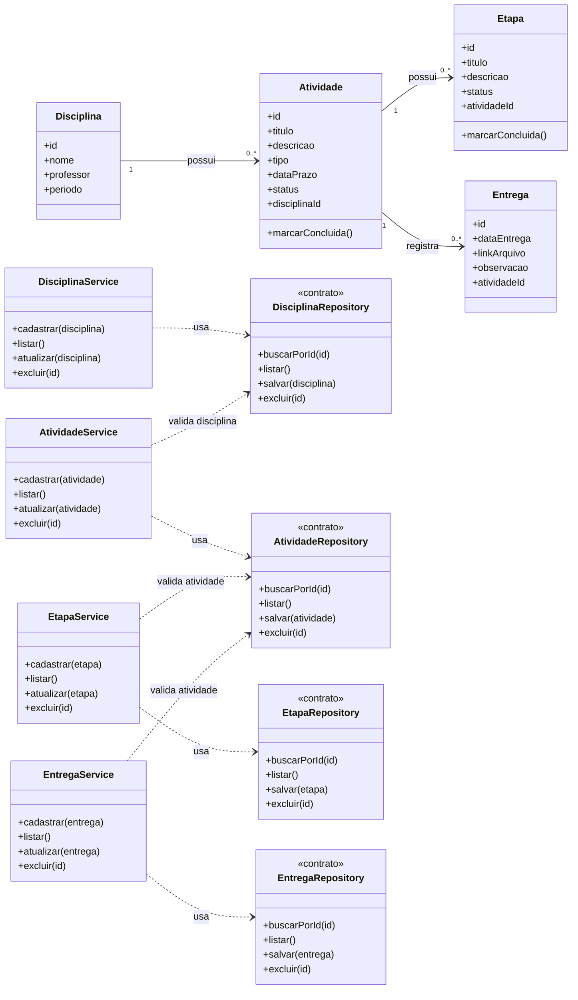

# Modelagem — Projeto 1

**Aluno(a):** Thawan Rodrigues Gomes
**Domínio:** "Sistema de organização de atividades acadêmicas."

## 1. O domínio

Permite aos estudantes cadastrar disciplinas, gerenciar trabalhos e provas e acompanhar seus prazos e etapas.

## 2. Entidades

| Entidade | Atributos | Relacionamentos |
|---|---|---|
| Disciplina | id, nome, professor, periodo | possui várias atividades |
| Atividade | id, titulo, descricao, tipo, dataPrazo, status, disciplinaId | pertence a uma disciplina e pode possuir várias etapas e entregas |
| Etapa | id, titulo, descricao, status, atividadeId | pertence a uma atividade |
| Entrega | id, dataEntrega, linkArquivo, observacao, atividadeId | pertence a uma atividade |

## 3. Diagrama de classes



## 4. Responsabilidades

| Classe | Papel | Único motivo para mudar |
|---|---|---|
| Disciplina, Atividade, Etapa, Entrega | entidades | as regras e os dados próprios de cada objeto |
| DisciplinaService, AtividadeService, EtapaService, EntregaService | regras de negócio | as regras de cadastro, atualização e exclusão das entidades |
| DisciplinaRepository, AtividadeRepository, EtapaRepository, EntregaRepository | acesso aos dados | a forma de guardar no banco |

## 5. Onde apliquei SRP e DIP

- **SRP:** cada classe possui uma responsabilidade específica. As entidades representam os dados e as regras próprias do domínio, os services coordenam as operações de negócio e os repositories definem os contratos para acessar os dados. Dessa forma, nenhuma entidade é responsável por salvar seus próprios dados.
- **DIP:** os services dependem dos contratos dos repositories, e não de implementações concretas de armazenamento. Os contratos podem ser implementados por diferentes mecanismos, como armazenamento em memória ou banco de dados, sem exigir que as regras de negócio dependam diretamente dessas tecnologias.

## 6. Fora do escopo (YAGNI)

Login, multas, reservas e relatórios não entram no Projeto 1.
````

Como ler o diagrama (a linguagem se chama **Mermaid**, e o GitHub desenha sozinho):

| Escrita | Significado |
|---|---|
| `class Nome { ... }` | uma classe, com atributos e métodos (um por linha) |
| `+atributo` e `+metodo()` | o `+` indica que é público |
| `<<contrato>>` | a classe é um contrato: só a lista de métodos que o service exige |
| `A "1" --> "0..*" B : faz` | relacionamento: um A para vários B |
| `A ..> B : usa` | dependência: A usa B (seta tracejada) |